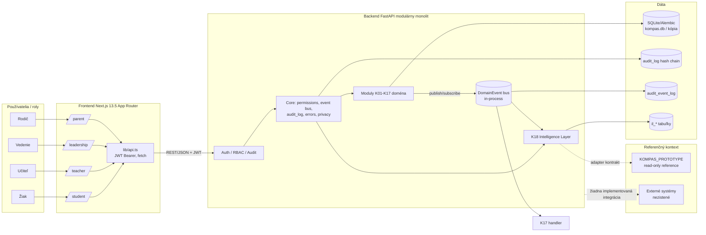
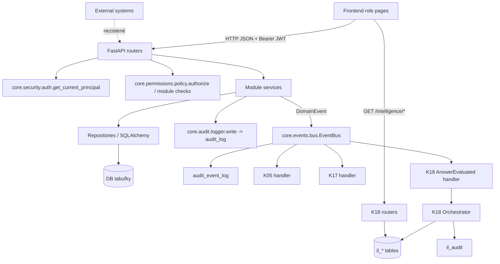
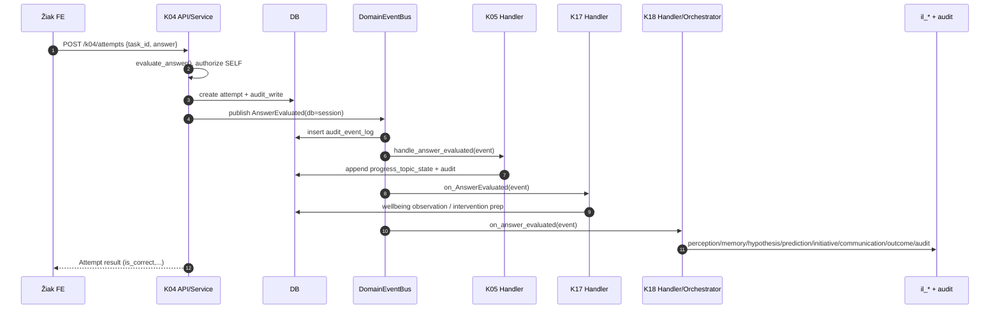
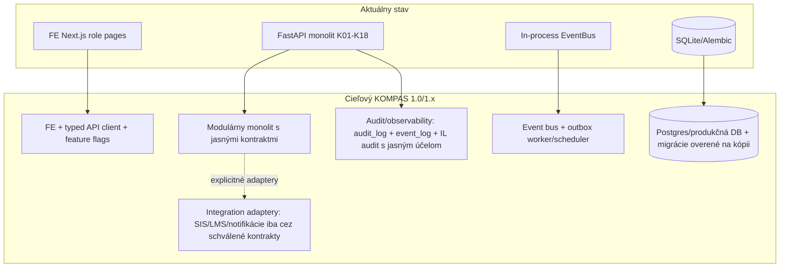

# KOMPAS — informačná architektúra a dátové toky

**Typ dokumentu:** read-only analytická mapa (bez zmien kódu, DB, konfigurácie, deployu).  
**Dátum analýzy:** 2026-11-23  
**Workspace:** `/data/data/com.termux/files/home/KOMPAS` (git `master`, HEAD `ac17e78`, čistý pracovný strom pri kontrole).  
**Referenčný prototype:** `/data/data/com.termux/files/home/KOMPAS_PROTOTYPE` (izolovaný, runtime nezávislý).

## 1. Executive summary

KOMPAS je modulárny monolit: **FastAPI + SQLAlchemy backend** (`backend/app`, moduly K01–K18), **Next.js 13.5 App Router frontend** (`frontend/src`) a **SQLite/Alembic DB** (`.data/kompas.db`, migrácie v `db/migrations/versions`). Komunikácia FE↔BE je primárne **REST/JSON cez `fetch`** s JWT Bearer tokenom (`frontend/src/lib/api.ts`, `backend/app/core/security/*`). Interná backend komunikácia je kombinácia **priameho volania service/repository vrstiev** a **in-process DomainEvent busu** (`app/core/events/bus.py`) s audit logom udalostí.

Kľúčový integrovaný tok učenia: **K04 odovzdanie pokusu → `AnswerEvaluated` DomainEvent → K05 zapíše stav učiva (append-only, efektívny stav cez `resolve_effective_states`) → K17 wellbeing handler → K18 Intelligence Layer orchestrátor**. K18 pridáva percepciu, pamäť, hypotézy, predikcie, iniciatívy, komunikáciu, outcome, audit, outbox/inbox/DLQ a integračné/simulačné/ops endpointy. K17 aj K18 sú subscriberi rovnakého eventu; kompatibilita je zachovaná registráciou modulov v `backend/app/main.py`.

Kritické zistenia: existujú **dva audit mechanizmy** (`audit_log` hash chain v `core/audit/logger.py` a K18 `il_audit`; EventBus persistuje aj `audit_event_log`). **Žiadne externé integrácie** (webhook/cron/scheduler/celery/redis/rabbit/kafka/smtp/email/sms/SIS/gradebook) neboli v kóde zistené grepom. K18 má outbox/inbox/DLQ tabuľky a `/intelligence/ops/*` endpointy, ale **produkčný worker/scheduler nie je zistený**; spracovanie je možné manuálne/cez ops endpointy a event handler beží in-process pri publish. Originálna DB má alembic mismatch (`818426796485` vs head `b7a0d74fa430`) a vyžaduje bezpečný stamp plán so súhlasom; K18 tabuľky sú však v origináli prítomné podľa predchádzajúcej kontroly v handoffe.

## 2. Rozsah a metodika

### Zahrnuté

- K01–K18 moduly: routery, services, repository, domain/models, event handlers, testy (existencia/pokrývanie názvov).
- Core: `main.py`, event bus, auth, permissions/policy, audit logger, DB session/migrácie.
- Frontend: role stránky `student/teacher/leadership/parent`, `lib/api.ts`, `lib/types.ts`, K18 feature flag.
- KOMPAS_PROTOTYPE: integračný kontrakt a štruktúra ako referencia; **nie runtime závislosť**.
- Bezpečnosť/viditeľnosť: RBAC, scope, tenant/school boundary, neutralita K17/K18 komunikácie.

### Metodika a dôkazy

- Statická analýza zdrojákov (`grep`, čítanie súborov, zoznam routerov/testov, git log).
- Dôkazy uvádzam ako `cesta:riadok` alebo `cesta` + názov funkcie/endpointu/modelu/testu.
- Nevykonával som zmeny v kóde/DB/config. Neprehlasujem runtime stav, ktorý nie je priamo overený v tomto behu; kde vychádzam z odovzdaného handoffu, označujem to.

### Limity

- Neexistuje plný produkčný E2E/browser dôkaz v tomto Termux behu; handoff uvádza dev runtime smoke na izolovanej DB kópii.
- Neoveroval som reálne externé systémy mimo repozitára.
- Niektoré pravidlá sú produktové/UNKNOWN (Q1, Q5, Q6).

## 3. Systémový kontext



**Dôkazy:** FE stránky `frontend/src/app/{student,teacher,leadership,parent}/page.tsx`; API klient `frontend/src/lib/api.ts:1-120`; registrácia modulov `backend/app/main.py:39-79`; event bus `backend/app/core/events/bus.py`; auth routes `backend/app/core/security/routes.py`; audit `backend/app/core/audit/logger.py`; K18 modely `backend/app/modules/k18_intelligence/repository/models.py`; prototype kontrakt `/data/data/com.termux/files/home/KOMPAS_PROTOTYPE/docs/INTEGRATION_CONTRACT.md`.

## 4. Inventár modulov a zodpovedností

| Modul | Zodpovednosť (podľa kódu) | Hlavné API/komponenty | Stav |
|---|---|---:|---|
| Core/Auth | Login/logout/change-password, JWT, revokácia, lockout/rate limit, principal | `/auth/*` `routes.py`; `auth.py:get_current_principal` | IMPLEMENTOVANÉ A OVERENÉ (testy v repozitári nepriamo, smoke podľa handoffu) |
| Core/Permissions | Deny-by-default scopes SELF/GUARDIAN_OF/TEACHES_CLASS/SCHOOL_AGGREGATE/SCHOOL_INDIVIDUAL_WITH_PURPOSE | `core/permissions/policy.py:authorize` | IMPLEMENTOVANÉ A OVERENÉ (použité v K01-K14, K16, K18 access) |
| Core/EventBus | In-process publish/subscribe, audit_event_log persistencia, session context | `bus.py:DomainEvent,EventBus,publish,subscribe,current_session` | IMPLEMENTOVANÉ A OVERENÉ (K04/K05/K17/K18 testy) |
| Core/Audit | Hash-chain audit log | `core/audit/logger.py:AuditLog,write,verify_chain` | IMPLEMENTOVANÉ A OVERENÉ (používané naprieč modulmi) |
| K01 Learning Profile | Profil žiaka, latest profil | `/k01/profiles/*`, frontend student | IMPLEMENTOVANÉ A OVERENÉ |
| K02 Subject Workspace | Predmetový priestor | router `k02_subject_workspace/api/router.py` | IMPLEMENTOVANÉ, ALE NEOVERENÉ v tomto behu |
| K03 Adaptive Learning | Odporúčania ďalšieho kroku | `/k03/recommendations/{user}` | IMPLEMENTOVANÉ A OVERENÉ |
| K04 Missions | Misie/úlohy/pokusy, vyhodnotenie odpovede, publish `AnswerEvaluated` | `/k04/missions*`, `/k04/attempts*`; `service.py:submit_attempt` | IMPLEMENTOVANÉ A OVERENÉ |
| K05 Knowledge Continuity | Append-only stav učiva, efektívny stav | `/k05/states/{user}`; handler `AnswerEvaluated` | IMPLEMENTOVANÉ A OVERENÉ |
| K06 Virtual Lab | Virtuálne laboratórium | router `k06_virtual_lab/api/router.py` | IMPLEMENTOVANÉ, ALE NEOVERENÉ v tomto behu |
| K07 Professional Library | Knižnica materiálov | `/k07/items` | IMPLEMENTOVANÉ A OVERENÉ |
| K08 Work Assistant | Drafty učiteľa, submit na schválenie | `/k08/drafts*` | IMPLEMENTOVANÉ A OVERENÉ |
| K09 Class Overview | Triedy učiteľa, prehľad stavov triedy | `/k09/classes*` | IMPLEMENTOVANÉ A OVERENÉ |
| K10 Organization Center | Plány/úlohy organizácie | `/k10/plans,/tasks` | IMPLEMENTOVANÉ A OVERENÉ |
| K11 Operations Center | Prevádzkové požiadavky, prechody stavov | `/k11/requests*` | IMPLEMENTOVANÉ A OVERENÉ |
| K12 Analytics Center | Agregovaný školský prehľad, threshold/suppression | `/analytics/overview`, `/analytics/students/{id}` | IMPLEMENTOVANÉ A OVERENÉ |
| K13 Parent Center | Prepojené deti, agregovaný prehľad, bez súkromných poznámok | `/parent/children*` | IMPLEMENTOVANÉ A OVERENÉ |
| K14 Communication Center | Vlákna/správy, participant check | `/communication/threads*` | IMPLEMENTOVANÉ A OVERENÉ |
| K15 Collaboration Projects | Projekty/spolupráca | router `k15_collaboration_projects/api/router.py` | IMPLEMENTOVANÉ, ALE NEOVERENÉ v tomto behu |
| K16 Intelligent Core | Zdroje, context memory, orchestrator run, audit report | `/k16/*` | IMPLEMENTOVANÉ, ALE NEOVERENÉ end-to-end v tomto behu |
| K17 Wellbeing Companion | Pozorovanie wellbeing signálov z `AnswerEvaluated`, neutrálne intervencie | `/k17/wellbeing/*`, handler | IMPLEMENTOVANÉ A OVERENÉ (testy existujú) |
| K18 Intelligence Layer | Percepcia→pamäť→reasoning→predikcia→iniciatíva→komunikácia→adaptácia→evaluácia, safety, RBAC, audit, ops/outbox/DLQ, integration/simulation | `/intelligence/*`, `/integration/*`, `/simulation/*` | IMPLEMENTOVANÉ A OVERENÉ (modulové testy podľa handoffu); produkčný worker/deploy BLOCKED |

## 5. Komunikačná mapa



| KTO | ČO POSIELA | KOMU | AKO | KAM SA TO ULOŽÍ | KTO TO VIDÍ | Dôkaz |
|---|---|---|---|---|---|---|
| Používateľ (FE) | username/password, voliteľne school_id | `/auth/login` | REST POST JSON | `identity_user` čítaný, `audit_log` zápis, token nie je persistovaný ako plaintext | Klient dostane JWT | `frontend/src/lib/api.ts:login`, `core/security/routes.py:login`, `core/security/auth.py:create_access_token` |
| FE klient | Bearer JWT | chránené endpointy | `Authorization` header | Revoked token tabuľka pri logout; principal z tokenu | Backend podľa role/scope | `api.ts:apiFetch/getToken`, `auth.py:get_current_principal`, `routes.py:/logout` |
| Žiak FE | pokus na úlohu | `POST /k04/attempts` | REST | `learning_attempt`/K04 modely, `audit_log`, `audit_event_log` cez bus persist | Žiak (svoje pokusy), učiteľ/vedenie podľa agregácií | `student/page.tsx` volá `/k04/attempts`, `k04_missions/services/service.py:submit_attempt`, `bus.py:_persist` |
| K04 service | `AnswerEvaluated` DomainEvent | EventBus | in-process publish v rovnakej DB session | `audit_event_log` + handler side-effects | Interné moduly K05/K17/K18 | `k04_missions/services/service.py:86-99`, `bus.py:publish` |
| K05 handler | stav učiva | `progress_topic_state` | append-only zápis cez service | `progress_topic_state` + audit | Žiak/učiteľ/rodič/vedenie cez role API (agregované/filtrované) | `k05_knowledge_continuity/events/handlers.py`, `shared/progress.py:resolve_effective_states` |
| K17 handler | wellbeing pozorovanie/intervenčná príprava | K17 service | in-process handler | K17 tabuľky/logika (podľa modulu), audit pri čítaní endpointov | Učiteľ/vedenie signály; žiak len neutrálna správa cez endpoint podľa policy | `k17_wellbeing_companion/events/handlers.py`, `k17_wellbeing_companion/api/router.py` |
| K18 handler | `mission_answer` mapovaný payload | K18 orchestrátor | in-process, reuses current session alebo vlastná SessionLocal | `il_perception_event`, `il_context_memory`, `il_hypothesis`, `il_prediction`, `il_initiative`, `il_communication`, `il_outcome`, `il_audit` | Podľa K18 RBAC/scope endpointov | `k18_intelligence/events/handlers.py`, `services/orchestrator.py:process_event`, `repository/models.py` |
| Teacher FE | triedy, knižnica, drafty, K18 situácie | `/k09/*,/k07/*,/k08/*,/intelligence/situations` | REST | doménové tabuľky K07-K09 + audit; K18 dismiss/ack audit | Učiteľ v rámci školy/priradenia | `teacher/page.tsx`, `k09/k07/k08 routers`, `k18 router.py` |
| Leadership FE | analytics, plány, požiadavky, K18 report | `/analytics/*,/k10/*,/k11/*,/intelligence/report/system` | REST | doménové tabuľky + audit; K18 report read-only agregácia | Vedenie školy | `leadership/page.tsx`, `k12/k10/k11 routers`, `k18 router.py:report_system` |
| Parent FE | deti, prehľad, vlákna/správy | `/parent/*,/communication/*` | REST | čítanie K13 agregátov; správy K14 tabuľky + audit | Rodič len prepojené dieťa/participant | `parent/page.tsx`, `k13_parent_center/service.py`, `k14_communication_center/service.py` |
| Ops/leadership | outbox enqueue/process-once, DLQ | `/intelligence/ops/*` | REST | `il_outbox`, `il_inbox`, `il_dead_letter`, `il_audit` | Leadership/system podľa RBAC | `k18_intelligence/api/ops_router.py`, `repository/outbox.py` |
| Integračný klient (budúci/KOMPAS) | domain event | `/integration/events` | REST adapter | K18 IL tabuľky cez orchestrátor, `il_audit` accepted/denied | Podľa auth; scope enforced | `k18_intelligence/api/integration_router.py`, `INTEGRATION_CONTRACT.md` |

## 6. End-to-end dátové toky



### Tok A — Žiak odovzdá úlohu

- Vstup: `student/page.tsx` volá `POST /k04/attempts`.
- K04: `K04Service.submit_attempt` kontroluje task/mission, autorizuje SELF (`Scope.SELF`), vyhodnotí `evaluate_answer`, uloží pokus, zapíše audit, publikuje `DomainEvent(event_type="AnswerEvaluated", payload={school_id, student_user_id, topic_id, attempt_ref, is_verification, correct})` (`k04_missions/services/service.py:57-99`).
- Bus: persistuje `audit_event_log`, nastaví current session context, dispatchne handlerov (`core/events/bus.py:51-88`).
- K05: mapuje verification/practice+correctness na `TopicProgressKind/Status`, volá `record_state` append-only; reuse publish session ak existuje (`k05_knowledge_continuity/events/handlers.py:10-73`). Efektívny stav sa počíta cez `shared/progress.py:resolve_effective_states` (verification môže znížiť, practice nesmie znížiť verified mastery).
- K17: vytvára wellbeing observation, pri alert level >=2 pripraví neutrálne prompt/intervention logiku; príprava na K-14 event je zakomentovaná (`k17_wellbeing_companion/events/handlers.py`).
- K18: mapuje na `mission_answer`, defaultuje entity na študenta, spracuje orchestrátor (`k18_intelligence/events/handlers.py`, `services/orchestrator.py:process_event`).

### Tok B — Učiteľ vidí triedu a situácie

- FE: `teacher/page.tsx` načíta `/k09/classes`, `/k07/items`, `/k08/drafts`, voliteľne `/intelligence/situations`.
- K09: `list_my_classes` len pre TEACHER; `get_class_overview` kontroluje priradenie učiteľa k triede cez `school_class_teacher` a policy TEACHES_CLASS (`k09_class_overview/services/service.py:23-90`).
- K18 situácie/notifikácie: filtrované `filter_initiatives_for_principal` + `can_access_student/_teacher_assigned_to_class`; dismiss vyžaduje leadership alebo teacher so scope na študenta (`k18_intelligence/api/router.py`, `api/access.py`).

### Tok C — Vedenie vidí agregáty a report

- FE: `leadership/page.tsx` volá `/analytics/overview`, `/k10/*`, `/k11/*`, `/intelligence/report/system`.
- K12: `get_school_overview` vyžaduje school scope; aplikuje threshold `analytics_min_group_size` (default 5) a potláča malé skupiny; audituje outcome (`k12_analytics_center/services/service.py`).
- K18: `report_system`, `audit`, `admin/*`, `ops/*` vyžadujú leadership (`require_leadership`, router/ops router).

### Tok D — Rodič vidí dieťa a komunikáciu

- FE: `parent/page.tsx` volá `/parent/children`, `/parent/children/{id}`, `/communication/threads`, `/communication/threads/{id}/messages`.
- K13: `list_children` len parent/system; `get_child_overview` autorizuje GUARDIAN_OF, vracia agregovaný progress + `teacher_notes` z repo, pričom repo explicitne vracia prázdny zoznam approved notes a komentuje, že TEACHER_PRIVATE_NOTE nesmie byť viditeľný (`k13_parent_center/services/service.py`, `repository/repository.py:57-63`).
- K14: prístup k vláknam/správam len pre účastníka alebo system; audituje create/post/read/list (`k14_communication_center/services/service.py`).

## 7. Datový model a zdroje pravdy

| Oblasť | Zdroj pravdy / model | Poznámka |
|---|---|---|
| Identita/role | `shared.identity.User`, `RoleAssignment`, `GuardianLink`, `RevokedToken` | JWT nesie sub/role/school_id/jti/pwd_ts; revokácia a zmena hesla invalidujú tokeny. |
| Škola/triedy/zápis | `shared.school.School`, `ClassGroup`, `Enrollment`, `school_class_teacher` (table metadata lookup) | K09/K18 teacher scope sa opiera o assignment + enrollment. |
| Kurikulum/témy | `shared.curriculum.Topic/Subject` (importované v `main.py`) | K04/K05/K09 používajú topic názvy/stavy. |
| Pokusy učenia | K04 attempt/task/mission modely | `AnswerEvaluated` payload nesie `is_verification`, `correct`, `attempt_ref`; Q1 time/errors nie sú garantované. |
| Stav učiva | `progress_topic_state` append-only | Zdroj pravdy pre „aktuálny“ stav je `resolve_effective_states`, nie posledný riadok. |
| Wellbeing | K17 observations/interventions (modulové tabuľky) | Neutrálne texty; žiak/rodič nevidia interný stav endpointom `/state`. |
| Inteligencia | K18 `il_perception_event`, `il_context_memory`, `il_hypothesis`, `il_prediction`, `il_initiative`, `il_communication`, `il_outcome`, `il_audit`, `il_outbox`, `il_inbox`, `il_dead_letter` | `event_id` unique v perception; outbox/inbox/DLQ pre asynchrónnu simuláciu. |
| Audit | `audit_log` hash chain (`core/audit/logger.py`) + `audit_event_log` (EventBus) + `il_audit` (K18) | Tri odlišné vrstvy: doménový audit, event log, IL audit. |

## 8. Stavové automaty a pravidlá

| Automat / pravidlo | Kde | Stav |
|---|---|---|
| Login lockout/rate limit | `core/security/routes.py`, `core/ratelimit.py` | IMPLEMENTOVANÉ A OVERENÉ podľa kódu |
| JWT revokácia/logout, invalidácia po zmene hesla | `auth.py:revoke_token,revoke_all_for_user,get_current_principal` | IMPLEMENTOVANÉ A OVERENÉ podľa kódu |
| K04 attempt evaluation: numeric akceptuje čiarku | `k04_missions/services/service.py:_normalise_number,evaluate_answer` | IMPLEMENTOVANÉ A OVERENÉ (handoff + kód) |
| K05 append-only + efektívny stav | `k05 handlers/service`, `shared/progress.py` | IMPLEMENTOVANÉ A OVERENÉ |
| K11 request transitions | `k11_operations_center` service/router (podľa FE `transition`) | IMPLEMENTOVANÉ, ALE NEOVERENÉ detailne v tomto behu |
| K12 suppression threshold | `k12_analytics_center/services/service.py:_apply_threshold`, `analytics_min_group_size` | IMPLEMENTOVANÉ A OVERENÉ |
| K18 dedup `event_id` | `perception/service.py`, `il_perception_event.event_id unique`, outbox/inbox | IMPLEMENTOVANÉ A OVERENÉ |
| K18 safety/neutralita/rate limit/human approval | `safety/service.py`, `communication` service | IMPLEMENTOVANÉ, ALE NEOVERENÉ všetky texty end-to-end |
| K18 outbox process-once/DLQ retry | `repository/outbox.py`, `api/ops_router.py` | IMPLEMENTOVANÉ, ALE NEOVERENÉ ako produkčný worker |
| Externý webhook/cron/scheduler | — | NEEXISTUJÚCE ALEBO NEZISTENÉ |

## 9. Bezpečnosť, tenancy, viditeľnosť, audit

```mermaid
flowchart LR
    REQ[Request] --> JWT[JWT decode + revoked/pwd_ts/active checks]
    JWT --> PRINC[Principal user/role/school]
    PRINC --> POL[authorize() deny-by-default scopes]
    POL --> MOD[Module-specific checks]
    MOD --> DATA[School-filtered query / entity scope]
    MOD --> AUD[audit_log.write success/denied]
    DATA --> RESP[Response]
```

- **Autentifikácia:** JWT HS256, issuer/audience, exp, jti, pwd_ts; revoked token tabuľka; password lockout. Dôkaz: `core/security/auth.py`, `core/security/routes.py`.
- **Autorizácia:** core `authorize()` deny-by-default so scopes `SELF`, `GUARDIAN_OF`, `TEACHES_CLASS`, `SCHOOL_AGGREGATE`, `SCHOOL_INDIVIDUAL_WITH_PURPOSE`; moduly dopĺňajú kontroly. Dôkaz: `core/permissions/policy.py`.
- **Tenancy/school boundary:** väčšina endpointov odvodzuje `school_id` z principal alebo ho validuje; K18 integration odmieta cross-school a entity scope pre non-leadership/non-system (`integration_router.py:38-52`).
- **Viditeľnosť rodiča:** K13 vracia agregovaný progress, `teacher_notes` sú prázdne a repo explicitne uvádza, že `TEACHER_PRIVATE_NOTE` sa rodičovi nesmie ukázať (`k13 repository.py:57-63`).
- **Viditeľnosť žiaka:** K17 `/students/{id}/state` blokuje žiaka a rodiča; žiak môže dostať neutrálnu intervenciu cez samostatný endpoint s kontrolou SELF/GUARDIAN_OF/TEACHES_CLASS. K18 komunikácia pre student/parent filtruje na vlastnú entitu.
- **Audit:** `audit_log` hash chain pre doménové akcie; EventBus persistuje `audit_event_log`; K18 zapisuje `il_audit`. K14 audituje aj čítanie správ.
- **Neutrálne texty:** K18 safety blokuje zakázané termíny a skóre pre student/parent; K17 vision je `neutral_observation_no_manipulation`.

## 10. Riziká, gapy, neznáme

| Oblasť | Zistenie | Klasifikácia | Dôkaz / poznámka |
|---|---|---|---|
| DB migrácie | Originál `.data/kompas.db` má `alembic_version=818426796485`, head `b7a0d74fa430`; priamy upgrade na kópii zlyhal `il_audit already exists`, stamp na kópii prešiel | ČIASTOČNE IMPLEMENTOVANÉ / BLOCKED | handoff; migrácie `f202ec1baf80`, `b7a0d74fa430` |
| K18 produkčný async | Outbox/inbox/DLQ a ops endpointy existujú, ale worker/cron/scheduler v kóde nezistený | ČIASTOČNE IMPLEMENTOVANÉ | `repository/outbox.py`, `api/ops_router.py`, grep na scheduler/webhook bez nálezu |
| Externé systémy | Žiadne webhooky, email/SMS, SIS, gradebook, message broker integrácie | NEEXISTUJÚCE ALEBO NEZISTENÉ | grep v `backend/app` bez nálezov |
| K18 integration ingest policy | `/integration/events` umožňuje prijatie po scope checku; produktová politika „leadership-in-school vs system-only“ nie je uzavretá | ČIASTOČNE IMPLEMENTOVANÉ | `integration_router.py`, handoff otvorené rozhodnutie |
| Q1 K-04 kontrakt | `time_taken_sec`, `consecutive_errors`, data quality nie sú plne kontraktované | NEZISTENÉ / UNKNOWN | K18 handler defaultuje `time_taken_sec=999`, `consecutive_errors=0` |
| Q5 retencia/compliance | Retencia 365d nie je compliance-schválená | UNKNOWN | `k18_intelligence/config.py`, docs |
| Q6 hodnotové jadro | Hodnotové/produktové pravidlá nie sú plne uzavreté | UNKNOWN | handoff |
| Frontend produkčný build/E2E | Dev server bežal podľa handoffu; produkčný build a browser E2E v Termuxe neuzavreté | IMPLEMENTOVANÉ, ALE NEOVERENÉ | handoff |
| Dva/tri audit logy | `audit_log`, `audit_event_log`, `il_audit` môžu vytvárať nejasnosť, ktorý je autoritatívny pre ktorý účel | ČIASTOČNE IMPLEMENTOVANÉ | `core/audit/logger.py`, `core/events/bus.py`, `k18 models.py` |
| K15/K02/K06 | Moduly registrované a majú routery/testy, ale neboli detailne mapované v tomto read-only behu | IMPLEMENTOVANÉ, ALE NEOVERENÉ | zoznam routerov/testov |

## 11. Návrh cieľovej architektúry



**Odporúčania (bez implementácie):**

1. **Uzavrieť DB migračný postup**: záloha originálu, overenie na kópii, `stamp`/`upgrade` podľa skutočného stavu, až potom zmena originálu.
2. **Formalizovať event kontrakty**: verzované payloady pre `AnswerEvaluated`/`mission_answer`, vrátane Q1 polí (`time_taken_sec`, `consecutive_errors`, `data_quality`) ako explicitne optional/required.
3. **Rozlíšiť audit vrstvy**: `audit_log` = compliance doménové akcie, `audit_event_log` = technický event stream, `il_audit` = IL rozhodovacia stopa; doplniť dokumentovaný účel.
4. **K18 async prevádzka**: ak sa má používať outbox v produkcii, doplniť riadený worker/scheduler a monitoring DLQ; inak označiť ako manuálny/diagnostický režim.
5. **Integration policy**: rozhodnúť, kto smie volať `/integration/events` a aké eventy sú dôveryhodné; pridať podpis/source allowlist.
6. **Frontend build/E2E**: stabilné prostredie mimo Termux limitov, TS/lint/build/E2E smoke pre všetky roly.
7. **Externé integrácie**: nerobiť priamy zápis do KOMPAS DB; používať adaptery + idempotentné eventy + audit.

## 12. Implementačný backlog

| Priorita | Položka | Cieľ | Riziko ak nezačaté | Závislosť | Stav |
|---:|---|---|---|---|---|
| P0 | DB migration safety runbook | Bezpečne zosúladiť originál DB s Alembic head | poškodenie dát, neaplikovateľné migrácie | záloha, súhlas | ČIASTOČNE IMPLEMENTOVANÉ |
| P0 | Integration ingest policy | Uzavrieť kto smie posielať `/integration/events` | spoofing/cross-tenant riziko pri chybnej konfigurácii | security review | ČIASTOČNE IMPLEMENTOVANÉ |
| P1 | Event contract v1 (K04/K05/K17/K18) | Stabilné payloady, Q1 rozhodnutie | tiché defaulty, nesprávne wellbeing/IL signály | produktové rozhodnutie | ČIASTOČNE IMPLEMENTOVANÉ |
| P1 | Frontend build/lint/E2E pipeline | Overiteľný release kandidát | regresie UI/typov | Node/CI prostredie | ČIASTOČNE IMPLEMENTOVANÉ |
| P1 | K18 ops runbook | Jasný režim outbox/DLQ, retry, monitoring | neviditeľné zlyhané eventy | worker rozhodnutie | ČIASTOČNE IMPLEMENTOVANÉ |
| P2 | Audit model unifikácia | Jednoznačný význam audit vrstiev | compliance/forenzná nejasnosť | dokumentácia + prípadné schéma rozšírenie | NAVRHNUTÉ |
| P2 | K15/K02/K06 detailná mapa | Doplniť chýbajúce end-to-end toky | skryté integračné dlhy | čas na analýzu/testy | NAVRHNUTÉ |
| P3 | Externé adaptery (SIS/LMS/notifikácie) | Bezpečná integrácia mimo DB | vendor lock-in, bezpečnostné riziká | kontrakty, právny/compliance rámec | NAVRHNUTÉ, ALE NEIMPLEMENTOVANÉ |

## 13. Otvorené otázky pre človeka

1. **Q1 (K-04 kontrakt):** majú byť `time_taken_sec`, `consecutive_errors`, `data_quality` povinné v `AnswerEvaluated`? Ak áno, aké defaulty/validácie?
2. **Q5 (retencia/compliance):** je 365 dní retencia IL dát schválená? Aké sú požiadavky na anonymizáciu/purge?
3. **Q6 (hodnotové jadro):** aké intervencie K17/K18 sú produktovo prípustné pre žiaka/rodiča/učiteľa?
4. **Integration ingest policy:** môže `/integration/events` volať len system/leadership, alebo aj iné dôveryhodné interné klienty so service identity?
5. **K-16 vs K-18:** rozšíriť K16 alebo ponechať K18 ako samostatnú vrstvu s adaptermi?
6. **DB originál:** mám pripraviť presný bezpečný runbook pre zálohu + stamp/upgrade originálu `.data/kompas.db` bez vykonania zmeny?
7. **Produkčný async:** má K18 outbox bežať cez cron/worker, alebo zatiaľ iba manuálne ops endpointy?

## 14. Prílohy: dôkazy, odkazy na súbory, príkazy, protokoly

### Kľúčové súbory

- `backend/app/main.py` — registrácia modulov, CORS, startup/shutdown K17 task.
- `backend/app/core/events/bus.py` — `DomainEvent`, `EventBus.publish/subscribe`, `audit_event_log`, `current_session`.
- `backend/app/core/security/auth.py`, `backend/app/core/security/routes.py` — JWT, revokácia, lockout, login/logout/change-password.
- `backend/app/core/permissions/policy.py` — deny-by-default scopes a visibility rules.
- `backend/app/core/audit/logger.py` — hash-chain `audit_log`.
- `backend/app/modules/k04_missions/services/service.py` — vyhodnotenie odpovede, publish `AnswerEvaluated`.
- `backend/app/modules/k05_knowledge_continuity/events/handlers.py` — zápis stavov učiva z eventu.
- `backend/app/modules/k17_wellbeing_companion/events/handlers.py`, `api/router.py` — wellbeing spracovanie a role endpointy.
- `backend/app/modules/k18_intelligence/*` — IL orchestrátor, modely, store, outbox, routers, access, tests.
- `backend/app/modules/k13_parent_center/services/service.py`, `repository/repository.py` — parent overview, guardian scope, approved notes.
- `backend/app/modules/k14_communication_center/services/service.py` — thread participant kontrola, audit čítania.
- `backend/app/modules/k12_analytics_center/services/service.py` — threshold/suppression.
- `frontend/src/lib/api.ts`, `frontend/src/lib/types.ts` — FE API klient, typy.
- `frontend/src/app/{student,teacher,leadership,parent}/page.tsx` — role dashboardy a volané endpointy.
- `docs/K18_INTELLIGENCE_LAYER.md` — K18 integračné poznámky.
- `/data/data/com.termux/files/home/KOMPAS_PROTOTYPE/docs/INTEGRATION_CONTRACT.md` — referenčný adapter kontrakt.

### Kontrolné príkazy použité pri analýze

```bash
git -C /data/data/com.termux/files/home/KOMPAS status --short
git -C /data/data/com.termux/files/home/KOMPAS log --oneline -8
find backend/app/modules -name router.py | sort
find backend/app/modules -name 'test_*.py' | sort
grep -rn "subscribe\|publish" backend/app --include='*.py'
grep -rn "webhook\|cron\|scheduler\|celery\|redis\|rabbit\|kafka\|smtp\|email\|sms" backend/app --include='*.py'
grep -RIn "apiFetch\|/k0\|/k1\|/intelligence\|/integration\|/auth/login" frontend/src/app --include='*.ts' --include='*.tsx'
```

### Pozorované výsledky

- `git status --short` — bez výstupu (čistý strom pred vytvorením tohto reportu).
- `git log --oneline -8` — posledné commity `ac17e78` až `dc92eed`.
- grep na webhook/cron/scheduler/broker/email/sms — **bez nálezov**.
- routery — 18 modulových routerov K01–K18.
- testy — 21 test súborov naprieč modulmi vrátane K18.

### Handoff dáta (prevzaté, nie znovu vykonané v tomto behu)

- K18: `10 passed, 45 warnings`; K18 ops integration `3 passed`; modulové balíky spolu `70 passed, 0 failed`.
- Frontend TS: PASS exit 0.
- Prototype: `29 passed, 0 warnings`.
- Originál DB: alembic mismatch, K18 tabuľky prítomné; kópia stamp PASS, upgrade no-op.

## 15. Plain-language záver

KOMPAS už má funkčné jadro: žiak sa vie učiť cez misie, systém vyhodnotí odpoveď, uloží ju, aktualizuje stav učiva a z tej istej udalosti vie vytvoriť wellbeing a intelligence signály. Učiteľ, vedenie a rodič majú oddelené pohľady a backend kontroluje, kto čo smie vidieť. Dôležité je, že rodič nedostáva súkromné učiteľské poznámky a žiak nedostáva interné wellbeing skóre.

Najväčšie nedokončené veci nie sú v základnom toku učenia, ale v „prevádzkovom dospelí“ systému: bezpečné zosúladenie databázových migrácií na origináli, uzavretie pravidiel pre externé integrácie, rozhodnutie o produkčnom spracovaní K18 outboxu a dokončenie build/E2E overenia frontendu. Externé systémy ako školský informačný systém, emaily alebo webhooky zatiaľ v kóde nie sú napojené; KOMPAS má na to pripravený integračný smer, ale nie hotovú produkčnú integráciu.